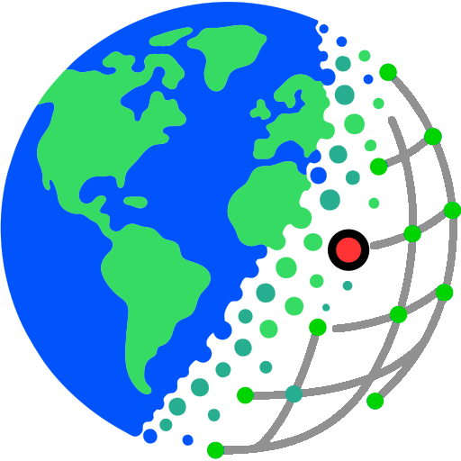

<h1 style="display: flex; align-items: center; gap: 12px;"> VecTiles.NET</h1>

VecTiles.NET is a .NET library suite that makes vector map data (vector tiles) usable in C#
applications. It covers the full pipeline:

- loading tile bytes from different sources (HTTP(S) tile servers, MBTiles/SQLite files, Mapsforge
  map files, PMTiles archives),
- converting Mapbox/OpenMapTiles vector tiles (MVT, PBF optionally zipped) and Mapsforge binary
  map tiles into feature objects,
- styling them with map styles in the [Mapbox style format](https://docs.mapbox.com/mapbox-gl-js/style-spec/)
  or with Mapsforge render themes, and
- rendering the styled map — fills, lines and symbols (with placed and HarfBuzz shaped text) — to
  bitmaps using SkiaSharp.

A ready-to-use Mapsui layer displays the rendered tiles inside a Mapsui map, and an Avalonia
sample app demonstrates the entire stack on top of it.

If a tile is not available at the requested zoom level, VecTiles.NET falls back to a tile of a
lower zoom level, fetches it and clips it to the requested tile (overzoom), so maps keep working
where data ends.

## Installation

VecTiles.NET targets `net10.0` and is available as five NuGet packages:

| Package | Content |
| --- | --- |
| [VecTiles.Common](https://www.nuget.org/packages/VecTiles.Common) | Core types and interfaces, common renderer abstractions and tile data sources (HTTP(S), MBTiles, PMTiles) |
| [VecTiles.OpenMapTiles](https://www.nuget.org/packages/VecTiles.OpenMapTiles) | Mapbox/OpenMapTiles (MVT) tile converter and Mapbox style support. Includes Protomaps PMTiles. |
| [VecTiles.Mapsforge](https://www.nuget.org/packages/VecTiles.Mapsforge) | Mapsforge map file tile converter and Mapsforge render theme support |
| [VecTiles.Skia](https://www.nuget.org/packages/VecTiles.Skia) | SkiaSharp based renderer for styled vector tiles |
| [VecTiles.Mapsui](https://www.nuget.org/packages/VecTiles.Mapsui) | Mapsui integration: the `RenderedTileLayer` for Mapsui map controls |

The easiest way to get started with Mapsui is to install `VecTiles.Mapsui`, which brings the other
packages along:

```sh
dotnet add package VecTiles.Mapsui
```

## Displaying a styled vector map in Mapsui

Add a Mapsui map control to your view (e.g. [`Mapsui.Avalonia`](https://www.nuget.org/packages/Mapsui.Avalonia))
and set up the rendered tile layer:

```csharp
using Mapsui;
using Mapsui.Projections;
using VecTiles.Controls.Mapsui;
using VecTiles.Controls.Mapsui.Extensions;

// Source of the style file in URL notation (see "Loading styles and tile data" below)
var styleSource = "file://Files/OpenMapTiles/osm-liberty.json";
// ... or from a tile server:
//var styleSource = "https://sgx.geodatenzentrum.de/gdz_basemapde_vektor/styles/bm_web_col.json";

// Loads the style file, its data sources and its sprites
var tileSource = new OMTRenderedTileSource(styleSource);

// The layer renders the styled vector tiles and shows them in the map.
// The geometry of the tiles is drawn immediately; symbols are placed in a
// background pass and fade in when it finishes.
var tileLayer = new RenderedTileLayer(tileSource);

MapControl.Map.Layers.Add(tileLayer);

// Zoom range of the tile schema, center and zoom from the style file
MapControl.Map.Navigator.OverrideZoomBounds = tileLayer.ZoomBounds;

var (center, zoom) = (tileSource.Center, tileSource.Zoom);
if (center.Length >= 2 && zoom is { } zoomLevel)
{
    var centerPoint = SphericalMercator.FromLonLat(center[0], center[1]);
    MapControl.Map.Navigator.CenterOnAndZoomTo(centerPoint, zoomLevel.ToResolution());
}
```

Attributions of the tile data declared in the style file are exposed by the tile source
(`Attribution` / `Attributions`), e.g. to show them as a widget below the map.

Optionally, a `RenderedTileLayer` accepts a `fontSourceResolver` that maps a font name from the
style file to a font file source, which is loaded when the font is neither registered nor
installed on the system.

## Displaying a map from a Mapsforge map file

`MFRenderedTileSource` loads a [Mapsforge](https://github.com/mapsforge/mapsforge) map file
(`mapsforge://…map`) and styles its tiles with a
[Mapsforge render theme](https://github.com/mapsforge/mapsforge/blob/master/docs/Rendertheme-V5.md):

```csharp
using VecTiles.Converters.Mapsforge;
using VecTiles.Controls.Mapsui;

// Loads the map file and the sprites and patterns referenced by the render theme
var tileSource = new MFRenderedTileSource(
    "file://Files/Mapsforge/zuerich.map",
    new MapsforgeTagsConverter(),                       // maps raw Mapsforge tags to the OpenMapTiles
    "file://Files/Mapsforge/mapsforge/osmarender.xml"); // schema; an IdentityTagsConverter keeps
                                                        // the raw tags for render themes instead

var tileLayer = new RenderedTileLayer(tileSource);
MapControl.Map.Layers.Add(tileLayer);
MapControl.Map.Navigator.OverrideZoomBounds = tileLayer.ZoomBounds;
```

The Mapsforge render theme format uses its own tag vocabulary, so a `MapsforgeTagsConverter` and a
Mapbox style based on the OpenMapTiles schema (e.g. `osm-liberty-for-mapsforge.json`) work with
Mapsforge map files as well. The rest of the setup (center, zoom, attribution) is identical to the
style based example above.

## Loading styles and tile data

VecTiles.NET addresses everything in URL notation. The `OMTStyleFileLoader` (used by
`OMTRenderedTileSource`) loads the style file itself via `ByteDataSource`, which supports:

| Scheme | Meaning |
| --- | --- |
| `file://` | File in the file system |
| `http://` / `https://` | Resource on a web server |
| `embedded://` | Embedded manifest resource |
| `svg-content://` | Source is the raw SVG content itself |
| `base64-content://` | Source is the base64 encoded content itself |

The tile sources referenced by the style file are created automatically:

| `url` / `tiles` entry | Data source |
| --- | --- |
| `http(s)://…/{z}/{x}/{y}.pbf` (`pbf` or `.pbf.gz`) | Tile server; also works with a TileJSON (`…​.json`), from which tile URLs, zoom range and attribution are resolved |
| `mbtiles://path/to/file.mbtiles` | MBTiles file (SQLite in Mapbox format) |
| `mapsforge://path/to/file.map` | Mapsforge map file (binary MAP format) |
| `pmtiles://file://path/to/file.pmtiles` or `pmtiles://https://host/file.pmtiles` | PMTiles archive (single file, read in byte ranges; HTTP(S) servers must support range requests) |

Examples for tile source URLs in a style file:

- `https://tiles.example.com/data/{z}/{x}/{y}.pbf` — vector tiles from a tile server
- `https://tiles.example.com/data/tilejson.json` — a TileJSON, from which the tile URLs, zoom
  range and attribution are resolved
- `file://Files/OpenMapTiles/zurich.mbtiles` — a local MBTiles file
- `pmtiles://https://latest.protomaps.com/v4.pmtiles` — a PMTiles archive on a web server
- `pmtiles://file://Files/Protomaps/zuerich.pmtiles` — a local PMTiles archive

Both are then wrapped in a `VectorTileDataSource` that converts the tile bytes with the matching
tile converter and applies the overzoom fallback described above: tile server, MBTiles and PMTiles
MVT payloads with the OpenMapTiles converter, Mapsforge tiles with the Mapsforge converter, whose tag
conversion by default maps the raw Mapsforge tags to the OpenMapTiles schema (so Mapbox style
based styles work unchanged on Mapsforge maps).

## How it fits together

`TileDataSource` → `TileConverter` → `VectorTileDataSource` → `Style` → `Renderer`
→ `RenderedTileLayer`

All of these are built around interfaces (`ITileDataSource`, `ITileConverter`,
`IVectorTileDataSource`, `IExpression`, `ILayerStyle`, `ISymbol`, `IPaint`, `IBitmap`), so single
parts can be replaced: e.g. a new tile source for another service or a renderer for another
graphics library.

## Sample application

[`Samples/Avalonia`](Samples/Avalonia) contains a desktop sample app that loads a local
[OSM Liberty](https://github.com/maputnik/osm-liberty) style, a
[Protomaps](https://protomaps.com) style from a local PMTiles archive or online styles, lets you
toggle the visibility of individual style layers, shows the feature info of the tapped position,
the mouse coordinates and a tile grid debug layer.

## Credits

VecTiles.NET builds on great open source projects. See [CREDITS.md](CREDITS.md) for the complete
list — many thanks to all their contributors! The licenses of the parts of those projects included
in VecTiles are collected in [LICENSE](LICENSE).
